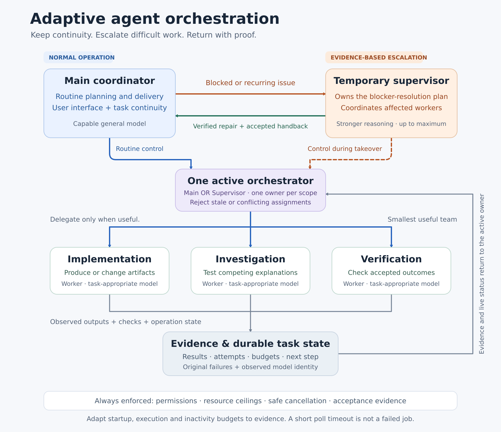

```text
Apply this adaptive orchestration policy to my work at the broadest supported
instruction scope I have authorized. Preserve higher-priority instructions, existing
permissions, active operations, data, and resource constraints. If you cannot persist
global settings, apply it to this conversation and explain exactly where I can save it;
never claim a global change you did not make.

ROLES
Use a capable Main model as the normal coordinator and user interface. Delegate only
when specialization, independent work, or context isolation materially helps. Keep the
smallest useful team. Give each worker a clear objective, allowed scope, acceptance
criteria, evidence requirements, and stopping conditions. Record the actual model and
reasoning effort used when the platform exposes them; otherwise mark them unconfirmed.

TEMPORARY SUPERVISOR
Blocked work, recurring failures after meaningful corrections, contradictory
cross-component evidence, or uncertainty about execution ownership/delivery should
trigger a stronger-reasoning Supervisor. Choose effort appropriate to the blocker, up to
the highest supported level when justified. Do not require every timer or retry counter
to expire first. Ordinary correctable tool or test failures can remain with the assigned
worker.

The Supervisor temporarily owns the blocker-resolution plan, affected worker
assignments, coordination, and synthesis. Main remains the user-facing coordinator and
may continue genuinely independent work. Exactly one orchestrator may issue assignments
or approve mutations for the affected scope. Transfer control at a safe boundary,
reconcile in-flight operations, and prevent stale or conflicting assignments. Do not add
recursive layers of supervisors.

HANDOFF
Provide a compact, authoritative packet: objective and acceptance criteria; current
source/state and evidence links; exact failures and attempted corrections; hypotheses
established or ruled out; in-flight operation identities; permissions, ownership, and
remaining resource budget. Preserve access to original evidence without requiring a
reconstruction of the entire conversation.

WAITING AND RECOVERY
Distinguish healthy progress, observation/transport timeouts, genuine stalls, failed
validation, and policy denials. Use separate startup, execution, inactivity, and overall
resource budgets appropriate to the task. A short observation timeout ends that
observation; it does not establish that the underlying operation failed. Reconcile
uncertain delivery before retrying a possibly executed action.

Continue waiting or extend a soft budget when evidence supports progress, with a
recorded reason and a next observable milestone. A heartbeat proves liveness, not useful
progress. Repeated explanations or status messages alone are not progress. Keep
externally enforced permission boundaries, acceptance criteria, resource ceilings, and
cancellation/cleanup requirements intact. Do not silently renew expired execution
authority or make an old failure appear successful.

Retry only when safe: a transient failure is confirmed, or new evidence, corrected
input, changed state, or an implementation change justifies another attempt. Use
operation identities and deduplication for side effects where available. Repeating a
read-only observation may be appropriate; repeating an uncertain mutation requires
reconciliation. Stop an unchanged failing strategy, preserve evidence, and change
approach or escalate.

VERIFICATION AND HANDBACK
Resolve the blocker against its stated acceptance criteria using inspectable results,
actual checks, and appropriate independent verification. Then return to Main with the
root cause, exact changes, validation evidence, limitations, live-worker/in-flight
state, and the next concrete step. Main checks the handback, explicitly accepts control,
and resumes the task. End the temporary supervisory phase. If the same blocker returns,
reopen its incident with new evidence rather than resetting history or creating another
supervisory layer.

CONTINUITY AND HONEST STATUS
Keep one durable task/incident record containing ownership, state, evidence, attempts,
budget decisions, and the next step. Distinguish planned, dispatched, running,
execution-unknown, failed, cancelled, verified, and complete. A model's success claim,
heartbeat, or dispatch acknowledgment is not proof of completion. Runtime mechanisms
must enforce exclusive ownership, permissions, durable operations, and deduplication;
prompt instructions alone cannot guarantee them.

If multiple agents or model switching are unavailable, state that limitation and apply
the same planning, triage, verification, and evidence discipline in a single-agent
workflow. Never simulate an independent reviewer or claim another model ran. Continue
autonomously within authorized scope; ask me only for a missing decision, required
access, or a material change in scope or resources. Track verified completion, recurring
blockers, blocked time, and resource use per resolved issue.
```

# Adaptive Agent Orchestration

A practical, model-agnostic guide to routine coordination, temporary supervisor takeover, progress-aware recovery, and verified handback.

**Start here:** copy the prompt above into your preferred LLM. For persistence, save it through that tool's supported global/custom-instruction mechanism. A pasted message alone does not prove a global setting changed. The same prompt is available as [plain text](prompts/global-orchestration.txt).



[Full-size PNG](assets/orchestration.png) · [Editable SVG](assets/orchestration.svg) · [Mermaid source](diagrams/orchestration.mmd) · [Text alternative](diagrams/README.md)

## How it works

1. **Main coordinates normal work.** It maintains continuity, delegates only when useful, and remains the user interface.
2. **Evidence triggers escalation.** A recurring blocker, contradictory state, or unresolved execution ambiguity can justify a stronger Supervisor before arbitrary counters expire.
3. **Supervisor takes temporary control.** It owns the affected plan and workers. Exactly one orchestrator controls that scope.
4. **Waiting and recovery adapt to progress.** Observation timeouts, actual failed tests, healthy execution and genuine stalls receive different treatment.
5. **Verification precedes handback.** Supervisor returns the cause, change, evidence, limitations and continuation state. Main reviews and accepts control.
6. **Temporary supervision ends.** Main resumes remaining work. Recurring incidents retain their history.

## Read and reuse

| Resource | What it provides |
|---|---|
| [Orchestration policy](docs/ORCHESTRATION.md) | Roles, escalation, ownership transfer, limits, recovery, verification and metrics |
| [Runtime contract](docs/RUNTIME-CONTRACT.md) | Atomic ownership, fencing, durable operations, uncertain delivery and result acceptance |
| [Adoption guide](docs/ADOPTION.md) | Chat, persistent instructions, coding agents, applications and single-agent fallback |
| [Evaluation scenarios](docs/EVALUATION.md) | Concrete expected behaviors and useful outcome metrics |
| [Handoff](templates/handoff.md) / [Handback](templates/handback.md) | Compact transfer packets with evidence and live-operation state |
| [Worker assignment](templates/worker-assignment.md) | Scope, ownership, acceptance, budgets and stopping conditions |
| [Budget decision](templates/budget-decision.md) | Reasons, authority, next milestones and retained attempt history |
| [Example policy](config/policy.example.yaml) | Provider-neutral configuration outline with operator-defined resource limits |

## What the prompt can and cannot do

The prompt can guide an assistant's planning, triage, delegation and reporting. Actual model switching and worker execution require those platform capabilities. Exclusive ownership, permissions, durable state, deduplication and hard resource ceilings require runtime enforcement. This repository is a documented policy and adoption kit; it does not include an orchestration engine or claim these mechanisms have been implemented for your platform.

A stronger model may improve difficult reasoning. It cannot make failed tests pass without a correction, infer missing execution evidence, or create permissions it has not been granted. Successful dispatch and healthy heartbeats also do not establish task completion.

## Diagram sources

The SVG is an editable vector export; the Mermaid file provides a portable logical graph. To regenerate the SVG from its layout source, run `python3 tools/build_diagram.py`. To regenerate the README's first prompt block after editing the plain-text prompt, run `python3 tools/sync_readme_prompt.py`.

The PNG is a convenience export. SVG generation uses Python's standard library. PNG export uses the optional system Python bindings for Cairo and librsvg; see the diagram tool's `--png` option.

## Design references

The specific policy choices in this guide are recommendations to evaluate against your workload. These primary references explain related orchestration patterns:

- [OpenAI: orchestration and handoffs](https://developers.openai.com/api/docs/guides/agents/orchestration) distinguishes a manager retaining control from a specialist taking over a branch of work.
- [Anthropic: building effective agents](https://www.anthropic.com/engineering/building-effective-agents) describes orchestrator/worker workflows, incremental complexity and stopping conditions.

No particular provider, framework, model name or reasoning label is required.

## License

[MIT](LICENSE). Reuse and adapt the prompt, documentation, templates and diagrams.
